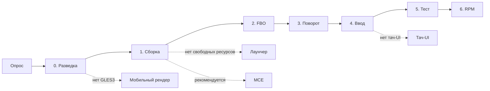
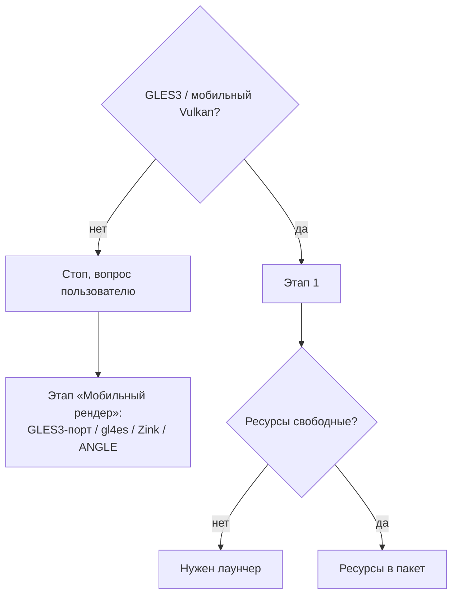
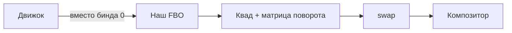
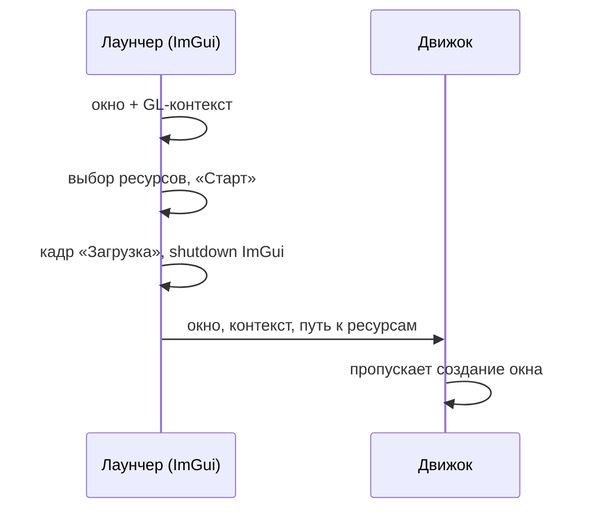

# Воркшоп: порт игры на ОС Аврора за час — тезисы слайдов

Демо-проект: Simpsons: Hit & Run (Android-порт, GLES3, ресурсы демо-версии).
Формат: агент работает, пока я на слайдах объясняю, что он делает.

Обозначения:
- `▶ Агент` — момент запуска агента, рядом — что ему сказать;
- `> Комментарий` — пояснение для себя, на слайд не идёт.

Примерный тайминг (60 мин):

| Блок | Что происходит | Время |
|---|---|---|
| 0 | Вступление | 3–4 мин |
| 1 | Опрос (старт сессии) | 5 мин |
| 2 | Этап 0 + этап 1: разведка и сборка | 12–15 мин |
| 3 | Этап 2: FBO + проверка на устройстве | 10–12 мин |
| 4 | Этапы 3–4: поворот и ввод | 10–12 мин |
| 5 | Тач-UI, геймпад, лаунчер | 10–12 мин |
| 6 | Итоги | 2–3 мин |

---

## Блок 0. Вступление

### Слайд 0.1 — Титул
- Порт игры на ОС Аврора за час: LLM-агент и набор скилов
- Имя, контакты, ссылка на репо `aurora-gameport`

### Слайд 0.2 — Что сделаем за час
- Возьмём игру с Android-портом на GLES3
- Отдадим агенту набор скилов
- Получим рабочий порт на устройстве с Авророй, в который можно играть

### Слайд 0.3 — Почему порт на Аврору — это не «просто пересобрать»
- Wayland без xdg-shell: только wl-shell и qt-extended-surface
- Композитор не поворачивает картинку: это делает приложение
- Приложение пишет файлы только в каталоги песочницы
- Всё собирается через sfdk под aarch64 и armv7hl
- Пакет нужно подписать и прогнать через валидатор

> Комментарий: здесь задаём проблему, которую дальше решает агент.
> Сказать, что каждый пункт — это отдельный документ в скилах.

### Слайд 0.4 — Что такое «набор скилов»
- `AGENTS.MD`: роль, правила, поэтапный план
- `docs/`: модули спеки, которые агент читает по условию («карта документов»)
- `examples/`: готовый код (лаунчер, ImGui, MCE, Maliit)
- Агент ведёт `port_status.md`, поэтому работу можно прервать и продолжить с того же места

> Комментарий: показать таблицу «Карта документов» из AGENTS.MD:
> агент не читает всё подряд, а подгружает нужное по этапу.
> Это экономит контекст и уменьшает число ошибок.

### Слайд 0.5 — Карта этапов
- Старт → 0 Разведка → 1 Сборка → 2 FBO → 3 Поворот → 4 Ввод → 5 Тест → 6 RPM
- Условные этапы: «Мобильный рендер», MCE, Лаунчер, Тач-UI, Клавиатура
- Режимы работы: `auto` и `manual`



---

## Блок 1. Старт сессии — опрос

`▶ Агент:` первый запуск, без дополнительных указаний.

### Слайд 1.1 — Агент сначала спрашивает
- URL проекта
- Путь до AuroraSDK (sfdk)
- Версия таргета (по умолчанию — последняя >= 5.1)
- Режим работы: `auto` или `manual`
- Идентификаторы приложения: `app_orgname`, `app_appname`, `app_launcher_name`

### Слайд 1.2 — Почему опрос обязателен
- Строгое правило: без полного конфига агент не начинает работу
- От идентификаторов зависят имя пакета, desktop-файл и пути песочницы
- Ответы сохраняются в `port_config.json`: это единый источник правды для spec и кода

> Комментарий: показать сгенерированный `port_config.json`.
> Обратить внимание, что агент сам предлагает план и предупреждает,
> на каких этапах понадобится человек (запуск на устройстве).
> Здесь же агент спрашивает про MCE (запрет гашения экрана).

---

## Блок 2. Разведка и сборка (этапы 0–1)

`▶ Агент:` «Выполни этап 0. Если проект совместим с GLES3 — переходи
к этапу 1 и остановись после сборки пакета под Аврору. Сразу добавь
аргументы командной строки, через которые передаётся путь к ресурсам игры.»

> Комментарий: флаг пути к ресурсам нужен в блоке 5: лаунчер будет
> передавать выбранный путь движку через него. Ресурсы демо-версии
> проприетарные, в пакет их класть нельзя.

### Слайд 2.1 — Этап 0: что ищет агент
- Систему сборки и зависимости (сначала в репозитории Авроры)
- Графический API: совместим ли с GLES3
- Где вызывается swap, куда рисуется сцена, где бинд бэкбуфера (`glBindFramebuffer(…, 0)`)
- Откуда движок берёт размер окна и экрана
- Где движок получает события ввода
- Как движок кэширует GL-состояние
- Все места, где игра пишет файлы

> Комментарий: это чеклист из `docs/render_pipeline_research.md`.
> Результат — `research/render_pipeline.md` и короткий дайджест
> в `port_status.md`. Пока разведка не закончена, код не меняется.

### Слайд 2.2 — Развилки этапа 0

- Наш случай: Android-порт уже на GLES3 → сразу этап 1
- Ресурсы проприетарные → в план попадает лаунчер

### Слайд 2.3 — Этап 1: сборка
- Только через sfdk: `build-init` → `prepare` → `build`
- Два таргета одной версии: aarch64 и armv7hl
- SDL2 и GLFW берутся только из форков с фиксами под Аврору
- Зависимости кладутся в `/usr/share/<name>/lib`, ищутся через rpath

### Слайд 2.4 — Платформенные ловушки, которые агент уже знает
- `WL_EGL_PLATFORM`: иначе `eglplatform.h` тянет X11 и сборка падает
- `PULSE_PROP_media.role=x-maemo` — до инициализации звука
- Пути записи → `~/.local/share|.cache|.config/<org>/<app>`
- Весь код порта — под дефайном: без него движок собирается как раньше
- Логику игры не трогаем, только рендер и платформу

> Комментарий: тезис «скилы = упакованный опыт». Каждый пункт
> на этом слайде когда-то стоил часов отладки.

### Слайд 2.5 — Результат этапа
- Пакет собран, коммит в истории
- `port_status.md`: дайджест разведки, план, чеклист
- Агент остановился — дальше решает человек

> Комментарий: показать `port_status.md` вживую. Отметить, что
> после каждого этапа есть коммит, к которому можно откатиться.

---

## Блок 3. FBO (этап 2) + первый запуск на устройстве

`▶ Агент:` «Выполни этап 2, собери пакет для устройства.»
После сборки: подписать, установить, запустить.

### Слайд 3.1 — Зачем промежуточный FBO
- Композитор не поворачивает буфер: это обязанность клиента
- Сцена рендерится в текстуру, перед swap текстура выводится квадом
- В этом же месте делаются поворот и масштаб (даунскейл / апскейл)



### Слайд 3.2 — Что меняет агент
- Бинд бэкбуфера заменяется биндом нашего FBO
- Движковые FBO не трогаем: для движка наш FBO — это «экран»
- Движок получает размер FBO вместо размера окна (EGL не трогаем)
- Перед swap — отрисовка квада с текстурой

### Слайд 3.3 — Требования к FBO-модулю
- Цвет — `GL_RGBA`; глубина + стенсил — один `DEPTH24_STENCIL8`
- Нет расширения → только глубина
- Только квад, без `glBlitFramebuffer`: блит не умеет ни поворачивать, ни масштабировать
- Без MSAA
- Всё готовится заранее, в кадре — никаких вычислений и аллокаций

### Слайд 3.4 — Опасное место: кэш GL-состояния
- Движок кэширует GL-состояние (viewport, биндинги)
- Сырой gl-вызов в обход кэша → рассинхрон → на экране «растянутая часть кадра»
- Правило: сначала API движка, иначе восстановить состояние из его кэша
- Прецедент из порта STK: долго искали ошибку в размерах, а это был viewport

> Комментарий: хорошая история для зала. Агент это знает заранее,
> потому что это записано в «Опасных местах».

### Слайд 3.5 — Проверка на устройстве
- Без подписи пакет на устройство не установится
- Критерий этапа: картинка через FBO без визуальных регрессий
- Поворота пока нет — это нормально

> Комментарий: здесь первый «вау» — игра на устройстве.
> Ориентация, скорее всего, ещё неверная, это сделано намеренно.

---

## Блок 4. Поворот и ввод (этапы 3–4)

`▶ Агент:` «Выполни этапы 3 и 4.»

> Комментарий: этап 4 (ввод) лучше сделать вместе с поворотом:
> без него тач промахивается, а тач-UI в блоке 5 опирается на него.

### Слайд 4.1 — Как композитор сообщает о повороте
- `wl_output::geometry` → `transform` (0 / 90 / 180 / 270)
- Это только информация: буфер никто не поворачивает
- SDL2 уже переводит это в `SDL_DISPLAYEVENT_ORIENTATION`, сырое событие повторно не разбираем

### Слайд 4.2 — Ответ клиента
- Поворачиваем квад готовой матрицей (в вершинном шейдере)
- Сообщаем композитору: `wl_surface_set_buffer_transform`
- В оба места идёт одно и то же значение
- Зачем композитору это знать: системные жесты и клавиатура Maliit работают в правильной ориентации

```c
wl_surface_set_buffer_transform(wmInfo.info.wl.surface,
                                WL_OUTPUT_TRANSFORM_90);
```

### Слайд 4.3 — Портретная и ландшафтная панель
- Одно и то же значение `transform` значит разное на телефоне и на планшете
- Тип панели определяется по нативному разрешению: один раз и при смене дисплея
- Ландшафтная игра на телефоне получает только 90 / 270

| Ориентация | Портретная панель | Ландшафтная панель |
|---|---|---|
| landscape | 90° | 0° |
| inverted_landscape | 270° | 180° |
| portrait | 270° | 180° |
| inverted_portrait | 90° | 0° |

> Комментарий: если захардкодить 90/270, порт сломается на планшете
> и внешнем мониторе. Это частая ошибка.

### Слайд 4.4 — Поворот ≠ ресайз
- При повороте resize-событий нет, размер окна и FBO не меняется
- Меняются только матрица квада и buffer transform
- При реальном ресайзе (другой дисплей, даунскейл) агент сам вызывает resize-обработчики движка

### Слайд 4.5 — Трансформация ввода
- Тач приходит в координатах дисплея
- Применяем обратный поворот и масштаб FBO → движок получает координаты в FBO
- Геймпад не трансформируем
- Критерий: тач попадает в кнопку в любой ориентации и при любом масштабе

> Комментарий: проверка на устройстве — покрутить телефон, потыкать меню.

---

## Блок 5. Тач-UI, геймпад, лаунчер

`▶ Агент:` «Сделай лаунчер (выбор пути к ресурсам, передача
через добавленные аргументы) и тач-UI.»

> Комментарий: по AGENTS.MD лаунчер обычно идёт до FBO. Мы
> намеренно делаем его в конце, поэтому явно говорим агенту.
> Перед тач-UI агент сначала проводит отдельную разведку.

### Слайд 5.1 — Лаунчер: зачем
- Ресурсы проприетарные → в пакет их класть нельзя
- Пользователь указывает путь к своей легальной копии игры
- Dear ImGui: лёгкий, на том же GLES3, без внешних зависимостей
- Эталон — `examples/launcher/`

### Слайд 5.2 — Лаунчер: главное ограничение
- Композитор убивает приложение, если окно исчезло хотя бы на мгновение
- Поэтому лаунчер и игра живут в одном окне и одном GL-контексте
- «Старт» → кадр «Загрузка» → выгрузка ImGui → движок берёт готовое окно
- GL-атрибуты окна = атрибуты движка



### Слайд 5.3 — Опции лаунчера (специфика проекта)
- Путь к ресурсам, проверка, что это нужная игра
- Настройки: масштаб рендера, прозрачность оверлея и т.п.
- Настройки сохраняются в песочнице между запусками
- Тач-вёрстка: размеры в миллиметрах, а не в пикселях

> Комментарий: здесь обсудить с залом, какие опции нужны именно SHAR.

### Слайд 5.4 — Тач-UI: раскладка
- Левая половина — плавающий стик
- Правая половина — тачпад камеры (эмуляция мыши)
- Кнопки действий — по потребностям игры
- Кнопка меню — всегда видна
- Не вплотную к краям: там системные жесты

> Комментарий: раскладка — это главная проектная специфика.
> Показать на устройстве, обсудить, что поправить.

### Слайд 5.5 — Тач-UI: инженерные правила
- Обязателен мультитач: каждый элемент следит за своим `fingerId`
- Кнопки вызывают action движка, а не эмулируют клавишу: так тач-UI переживёт смену биндингов
- Отдельный UI-FBO в разрешении экрана: UI остаётся чётким при даунскейле
- Оверлей только в геймплее; при подключении геймпада он скрывается

### Слайд 5.6 — Геймпад
- События геймпада идут в движок как есть, без трансформации
- Подключение геймпада скрывает тач-UI, отключение — возвращает
- Чтобы экран не гас при игре на геймпаде, нужен MCE

---

## Блок 6. Итоги

### Слайд 6.1 — Что получилось за час
- Игра собрана под Аврору, работает FBO, поворот, тач, есть лаунчер и тач-UI
- Вся история — в коммитах, по одному на этап
- Состояние — в `port_status.md`

### Слайд 6.2 — Что осталось за кадром
- Этап 5: полный прогон сценариев (сворачивание, внешний экран)
- Этап 6: финальный RPM под обе архитектуры, подпись, валидатор
- Опционально: MCE, клавиатура Maliit

### Слайд 6.3 — Главные выводы
- Агенту нужна не подсказка, а методичка: этапы, критерии, развилки, опасные места
- Документы подгружаются по условию: меньше контекста, меньше ошибок
- Человек принимает решения на развилках и смотрит на устройство
- Ссылка на репо, QR-код, вопросы

---

## Подстраховка на сцене

- Перед выступлением прогнать весь сценарий и сохранить ветку и `port_status.md` после каждого блока
- Если агент застрял или ушёл не туда — переключиться на сохранённую ветку: скилы позволяют продолжить с любого этапа
- Заранее подписанный и рабочий RPM на устройстве — на крайний случай
- Устройство выводить на экран через трансляцию или камеру, проверить заранее
